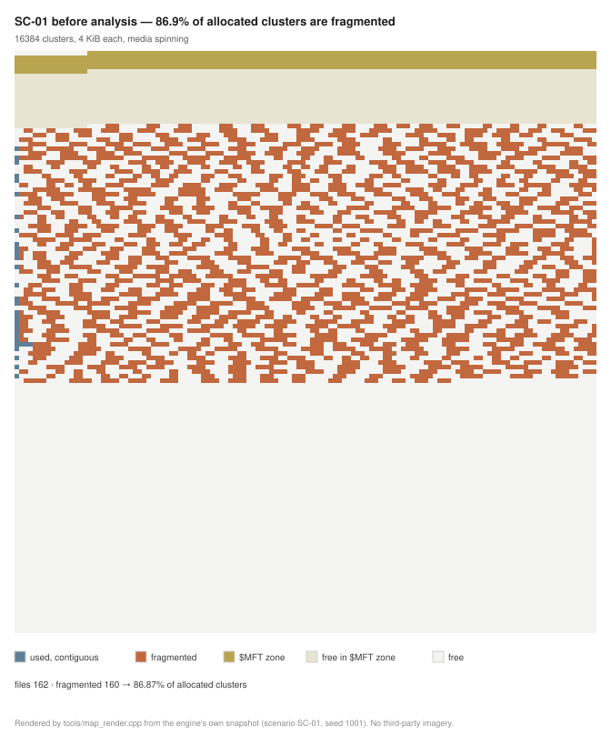
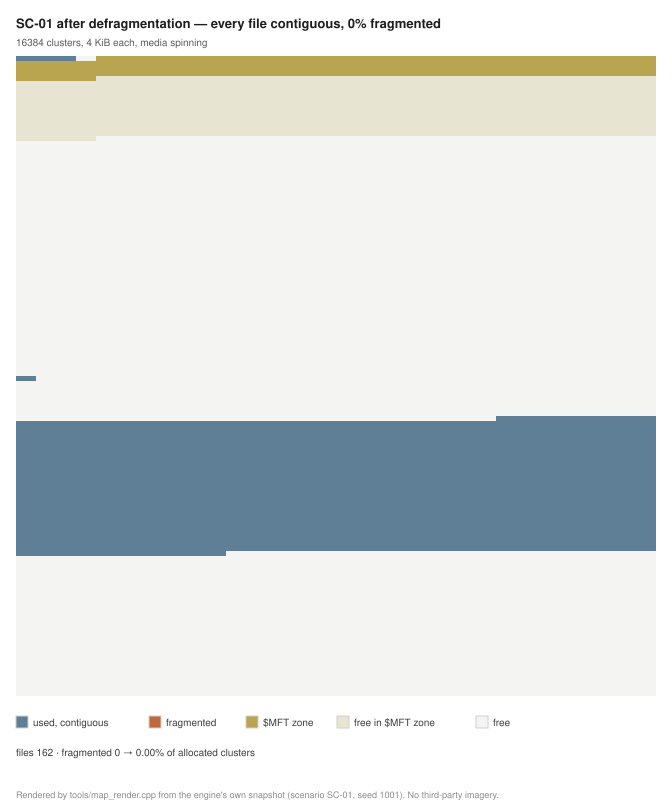

# AuraLite-Defrag — User Guide

AuraLite-Defrag defragments **NTFS volumes on Windows 10 (1809+) and Windows 11,
x64, in online mode** — that is, while the volume is mounted and in use. It is
licensed under Apache-2.0.

> **Platform scope.** Windows only. The Linux build in this repository exists to
> run the engine against a deterministic emulator for testing; it cannot touch a
> real volume and the CLI says so.

---

## 1. Safety first: what the program refuses to do

AuraLite-Defrag is deliberately conservative. Every one of the following
refusals is enforced in `PolicyGate`, which sits in front of the planner, the
executor and every entry point (UI, CLI, scheduler, shell menu). There is no
command-line flag, config key or registry setting that overrides them.

| Situation | Behaviour | Why |
|---|---|---|
| Solid-state or unknown media | Analysis only, exit code **12** | Defragmenting an SSD gains nothing and costs write endurance. `Unknown` is treated as SSD because guessing the other way is the expensive mistake. |
| Volume is dirty (`chkdsk` pending) | Refused, exit **11** | A dirty volume has unresolved metadata; moving clusters on top of it can compound the damage. |
| Volume is read-only | Refused, exit **11** | — |
| BitLocker-locked | Refused, exit **11** | — |
| Filesystem is not NTFS | Refused, exit **11** | FAT32/exFAT/ReFS are out of scope in v1. |
| Less than 5% free space | Refused, exit **11** | There is nowhere to move data to; attempting it makes fragmentation worse. |
| 5%–15% free space | Quick Defrag and Defrag Free Space only, with a warning | Full defragmentation cannot place large contiguous runs. |
| Not elevated | Refused, exit **13** | Volume metadata writes require administrative rights. |
| NTFS metadata files (`$MFT`, `$MFTMirr`, `$LogFile`, …) | Always skipped | Moving them can destroy the filesystem. |
| `pagefile.sys`, `hiberfil.sys`, `swapfile.sys` | Always skipped | Held by the kernel; moving them is not supported online. |
| Locked or in-use files | Skipped, reported | The volume is online; some files are always open. |
| Compressed, sparse, encrypted files or files with alternate data streams | Skipped unless the backend advertises support | These need stream-aware handling that v1 does not attempt. |

**Dry run.** `--dry-run` computes the complete plan and reports exactly what
would move, without moving a single cluster. Use it before any first run on a
volume you care about.

---

## 2. Modes

| Mode | What it does | When to use it |
|---|---|---|
| **Analyze** | Reads geometry, cluster bitmap, `$MFT` zone and per-file fragment counts. Read-only. | Always run this first. |
| **Defrag** | Consolidates fragmented user files into contiguous runs outside the `$MFT` zone. | The normal operation on a mechanical drive with ≥15% free space. |
| **Quick Defrag** | Defragments only files with many fragments, within a bounded cluster budget. | Volume is 5–15% free, or you want a fast pass. |
| **Defrag Free Space** | Compacts scattered files downward to consolidate free space into fewer, larger runs. | When the largest free run has become small. |
| **Move Large Files to End** | Relocates files ≥100 MiB (configurable) toward the end of the volume. | Keeps the fast outer tracks for the working set. |
| **Single file / folder** | Defragments one file or a folder subtree. | Targeted maintenance. |
| **MFT Optimize (Tier 3, default)** | **Reports** `$MFT` fragmentation and gives `fsutil behavior query mftzone` guidance. Changes nothing. | Safe default. |
| **MFT Zone Evacuate (Tier 2)** | Moves regular user files out of the reserved `$MFT` zone so the MFT can grow contiguously. | When Tier 3 reports zone occupancy by user files. |
| **MFT Optimize (Tier 1)** | Directly moves `$MFT` itself. Requires `--confirm-mft` **and** a backend that advertises the capability. | Advanced. Not enabled by default. |
| **Demo / Simulation** | Runs against the in-memory emulator on a scenario file. Touches nothing. | Learning the tool, reproducing a report, running tests. |

### About the four MFT tiers

The MFT is the NTFS index that describes every file. Online defragmentation of
`$MFT` itself is not a documented or supported operation, so AuraLite-Defrag does
not assume it works:

* **Tier 3 (default)** reports and advises. Nothing is moved.
* **Tier 2** avoids the MFT entirely and instead relocates ordinary files that
  are sitting in the zone reserved for MFT growth.
* **Tier 1** attempts a direct `$MFT` move and is hard-gated: it requires an
  explicit confirmation flag *and* a backend capability flag that the real NTFS
  backend leaves disabled by default.
* **Tier 4** (boot-time execution) is documented only, not implemented in v1.

The reservation itself is a Windows setting. AuraLite-Defrag **never** changes
`fsutil behavior set mftzone`; it only tells you what the current value is and
what it means.

---

## 3. Running from the command line

```
auralite-cli <verb> [options]
```

```powershell
# Look before you leap
auralite-cli analyze --volume D: --dry-run

# A normal defragmentation of D:
auralite-cli defrag --volume D:

# Try it on the emulator instead of a real disk
auralite-cli defrag --sim tests\scenarios\SC-01.json

# Produce a spreadsheet-safe report
auralite-cli export --volume D: --export-csv D:\reports\fragmentation.csv
```

See **[CLI_REFERENCE.md](CLI_REFERENCE.md)** for every verb, option and exit
code, verified against the implementation.

### Interpreting what you see

```
[100.00%] 960/960 moves, 3,414 clusters
Volume: D: (NTFS, 16,384 clusters, 12,454 free)
Files: 162 | Fragmented: 160 -> 0 | Volume Frag: 86.87% -> 0.00%
Moves completed: 960 | Verified: 960 | Skipped: 0
```

* **Volume Frag** is the share of allocated clusters belonging to fragmented
  files. 86.87% → 0.00% means every fragmented file ended up contiguous.
* **Verified** counts moves whose retrieval pointers were re-read after the move
  and found correct. `Verified` should equal `Moves completed`; if it ever does
  not, the run reports a verification error (exit 20).
* **Skipped** counts files the policy declined to touch — see the skip report
  for the reason per file.

---

## 4. Exclusions

Exclusions tell the program to leave files alone. They are checked in the
planner, so an excluded file never enters a plan at all.

```powershell
auralite-cli defrag --volume D: --exclude "*.vhdx" --exclude "D:\VMs\"
```

| Form | Meaning |
|---|---|
| `*.tmp`, `.tmp`, `ext:.tmp` | by extension |
| `name:*.bak` | by file name only |
| `category:media`, `category:archive` | by file category |
| `D:\VMs\`, `D:\VMs` | a directory and everything under it |
| `**\cache\**` | `**` crosses directories, `*` does not |

Rules can be edited in the GUI settings dialog or in `auralite.config.json`, and
exported/imported as JSON so a rule set can be shared between machines. Details:
`docs/dev/EXCLUSIONS.md`.

---

## 5. Exporting reports

`--export-csv <path>` writes RFC 4180 CSV with a UTF-8 BOM, a `SchemaVersion`
column and a header row. Names that begin with `=`, `+`, `-`, `@`, tab or CR are
neutralised with a leading apostrophe, so a file called `=cmd|calc.xls` cannot
execute anything when the report is opened in a spreadsheet. Non-ASCII names are
preserved byte-exactly.

There is **no HTML export** in v1, deliberately: HTML reports are the standard
way CSV-injection defences get bypassed.

---

## 6. What happens if the machine loses power

Every move is recorded in an append-only binary journal before and after it is
applied. On restart the journal is replayed: a step is counted as done only if
its completion record is present, so an interrupted move is retried rather than
double-applied, and a half-written record is discarded at the last checksum that
matches.

`docs/dev/CRASH_RECOVERY.md` documents the measured behaviour: 200 abrupt
termination trials across five crash points, 0 cases of silent corruption,
recovery in tens of milliseconds.

---

## 7. The cluster map and the file list

The map is the part of the window that answers "what is actually on this disk".
Each cell is one cluster — or several, once the volume is too large to draw
individually; the colour tells you what the cluster is doing.



*The image above is not a mock-up. It was produced by the engine analysing
scenario SC-01 through `tools/map_render.cpp`, drawing the same bitmap and MFT
zone geometry the GUI draws.*

| Colour | Meaning |
|---|---|
| Blue | In use, part of a contiguous run |
| Rust / orange | In use, part of a fragmented file |
| Gold | Inside the reserved `$MFT` zone, occupied |
| Pale sand | Inside the `$MFT` zone, free |
| Near-white | Free |

After a full defragmentation the same volume looks like this:



The rust disappears because every file became contiguous. The file list below
the map is the same data in rows — sortable by name, path, size, fragment count
and state, filterable by file type, with a per-file detail view showing the
extent run list.

**Honest note on the GUI.** The Win32/Direct2D front end is written but cannot be
compiled in the Linux environment this release was built in, so there is no
screenshot of the window here — and the clean-room rules forbid using anyone
else's screenshot to fill the gap. The images above are rendered from the same
data model, by our own code, and they carry the engine's real numbers. A real
capture will replace them when the GUI builds on Windows.

---

## 8. Known limitations (v1)

* **Windows only.** No Linux or macOS build of the real backend.
* **NTFS only.** No FAT32, exFAT, ReFS.
* **Online only.** No boot-time execution (Tier 4 is documentation).
* **No VSS integration.** Files locked by a snapshot provider are skipped.
* **SSD is analysis-only** with no override, by design.
* **No SMART data.** Media type is detected, health is not read.
* **Tier 1 MFT move is capability-gated off** in the shipped backend.
* The GUI is functional for map, file list, progress and export; tray
  notifications, UIA accessibility and the scheduler link are still in progress.

---

## 9. Where to look next

| You want… | Read |
|---|---|
| every CLI flag and exit code | [CLI_REFERENCE.md](CLI_REFERENCE.md) |
| to build it yourself | [../dev/DEVELOPER_GUIDE.md](../dev/DEVELOPER_GUIDE.md) |
| the architecture | [../dev/ARCHITECTURE.md](../dev/ARCHITECTURE.md) |
| why a decision was made | [../adr/README.md](../adr/README.md) |
| to file a bug | include the `--dry-run` output and the journal file |
